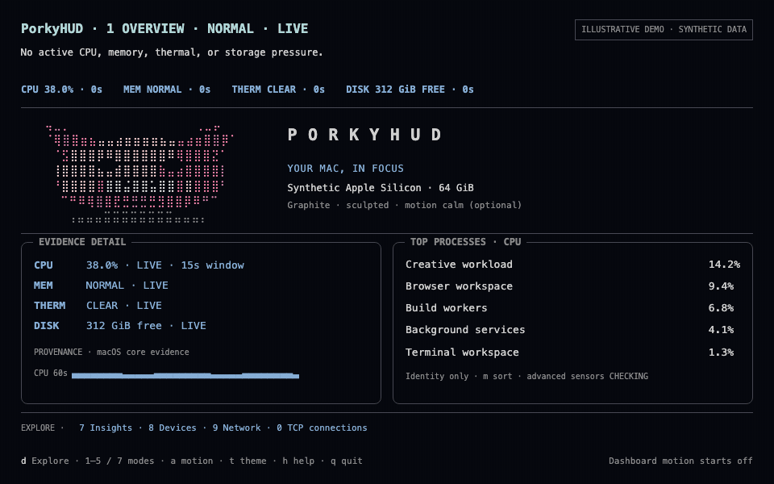

# PorkyHUD

PorkyHUD is a dependency-free, terminal-first decision cockpit for Apple Silicon Macs. It keeps four decision inputs—CPU capacity, macOS memory pressure, macOS thermal warnings, and writable storage headroom—separate from descriptive telemetry, so an attractive graph or plausible zero can never manufacture a health conclusion.

<p align="center">
  
</p>

<p align="center">
  <sub>Illustrative demo using fixed synthetic data. It is not evidence from a Mac.</sub>
</p>

## Install

Homebrew 6 trusts third-party taps explicitly:

```bash
brew trust --tap Mengjiehasaheart/porkyhud
brew tap Mengjiehasaheart/porkyhud
brew install porkyhud
porkyhud
```

The latest published Homebrew formula may lag this source checkout. The checkout
instructions below match the behavior documented on this page; verify the formula's
published version before treating Homebrew output as evidence for the current code.

Optional one-time advanced sensor setup:

```bash
porkyhud --setup-sensors
```

This asks for an administrator password and installs `/etc/sudoers.d/porkyhud`. The rule permits admin users to run only the bounded `powermetrics` sample commands that PorkyHUD generates. Check or remove it with:

```bash
porkyhud --sensor-access-status
porkyhud --remove-sensor-access
```

From a checkout, double-click `PorkyHUD.command` or run:

```bash
./PorkyHUD.command
```

The launcher and live dashboard normally apply a dark terminal palette. To preserve the terminal's foreground, background, and cursor colors:

```bash
NO_COLOR=1 porkyhud
```

## Reading the cockpit

The headline has two independent axes: severity (`NORMAL`, `WATCH`, `CRITICAL`, or `UNKNOWN`) and evidence readiness (`LIVE`, `DEGRADED`, `INCOMPLETE`, or `DELAYED`). `CHECKING` is the progressive-startup label while required evidence or the 15-second CPU baseline is still being collected.

The four health inputs are deliberately narrow:

- CPU: a complete, gap-bounded 15-second aggregate Mach CPU window; sustained use of at least 90% produces `WATCH`.
- Memory: the recognized macOS memory-pressure value; `2` produces `WATCH` and `4` is the only Phase 1 input that can produce `CRITICAL`.
- Thermal: an explicit macOS thermal or performance warning produces `WATCH`.
- Storage: the selected writable Data volume, or writable root fallback, produces `WATCH` only when free space is both below 10% and below 20 GiB.

RAM percentage, swap allocation, compression, temperatures, fan RPM, watts, GPU use, disk transfer, IOPS, network rate, and process activity are descriptive. They provide context but never drive severity.

Source and readiness labels preserve what is actually known:

| Label | Meaning |
| --- | --- |
| `CHECKING` | The initial attempt, retry, or required history is still in progress. |
| `LIVE` | Every required input is recognized, fresh, and decision-ready. |
| `DEGRADED` | A fresh warning is supported while another core input is incomplete. |
| `INCOMPLETE` | Required evidence never arrived, is unsupported/not applicable, is unrecognized, or lacks required history. |
| `DELAYED` | Previously valid required evidence is now blocked by staleness or a failed latest attempt. |
| `STALE` | A retained last-good value is older than its source freshness budget. |
| `LOCKED` | Only the optional advanced-sensor path needs credentials that `u` can temporarily unlock. |
| `PERMISSION DENIED` | A different source proved an access denial; no unrelated unlock is offered. |
| `UNSUPPORTED` | The capability is affirmatively unavailable on this environment. |
| `NOT APPLICABLE` | Evidence proves the source does not apply, such as an affirmed batteryless system. |
| `NOT EXPOSED` | A valid response contains no applicable optional field. |
| `ERROR` | A bounded command, decoder, or parser failed; PorkyHUD does not guess. |

Missing evidence prevents a `NORMAL` conclusion but cannot hide a supported warning. Retained last-good data remains visible with age and state, never as fresh decision evidence.

## Keyboard shortcuts

| Key | Action |
| --- | --- |
| `1`–`5` | Select Overview, Compute, Thermals, I/O, or Processes directly. |
| `6` | Select Cinema when the terminal is at least 118×34. |
| `l` | Cycle only modes supported by the current terminal size. |
| `h` or `?` | Show or hide current shortcut help. |
| `t` | Cycle the visual theme. |
| `a` | Cycle motion off → calm → vivid; every launch defaults to motion off. |
| `u` | Attempt a temporary advanced-sensor credential unlock when that source is `LOCKED`. |
| `m` | Cycle process sorting by CPU, memory, or GPU. |
| `r` | Request an immediate live refresh and reset source retry backoff. |
| `Up` / `Down` or `j` / `k` | Scroll processes. |
| `PageUp` / `PageDown` | Scroll processes by a page. |
| `Home` / `End` | Jump to the first or last process page. |
| `Esc` | Close help, or quit when help is closed. |
| `q` | Quit. |

Cinema is an optional wide presentation, not a different evidence policy. Resizing below its threshold returns to a supported operational mode.

## Snapshot interface and privacy

For diagnostics and future adapters:

```bash
./porkyhud.py --snapshot
./porkyhud.py --json
```

The snapshot schema is currently unversioned and is not a stable external API. It includes the machine hostname, process IDs, and sanitized process commands. Known secret-bearing flag values are redacted, but arbitrary positional arguments and unknown flag conventions may remain: process commands are sanitized, not guaranteed private. Review output before sharing it.

Snapshot collection is separate from the live HUD and cannot complete the sustained CPU history required for a global `NORMAL` conclusion. Raw command stderr and privileged command details are not included.

## Advanced sensor access

Most decision inputs work as a normal user. PorkyHUD reads AppleSMC directly for read-only fan and temperature keys when macOS exposes them. Deeper CPU/GPU power, die temperature, and residency counters may require the bounded `powermetrics` access described above.

Inside the dashboard, `u` performs only a temporary sudo credential refresh; it does not install the durable rule. If access is available but the model exposes no applicable field, the UI reports `NOT EXPOSED` instead of inventing a reading. Optional sensors never affect global severity or readiness.

## Compatibility and evidence

- Target: Apple Silicon on macOS, with Python 3.9 through 3.14 tested in CI.
- Current-host release-candidate record: deterministic hard gates, startup hard gates, snapshot/RSS/launch targets, timeout cleanup, a 30-minute no-growth soak, and the raw-PTY interaction matrix passed on one Mac17,6 / Apple M5 Max running macOS 26.6. Instrumented live CPU averaged 63.473% of one core and missed the scoped <=2% target. Physical Terminal.app visual/profile contrast, other terminal emulators, privileged sensors, and broad device coverage remain unverified.
- Fixture-validated, hardware-unverified: deterministic tests cover the changed memory-pressure, thermal, CPU-window, disk, process-attribution, responsive-layout, terminal, battery-present, and affirmed batteryless boundaries.
- Best effort: untested Apple Silicon devices and earlier macOS releases.
- Outside verified support: Intel Macs remain unverified until Intel-specific fixtures and physical evidence exist.

A fixture can prevent a known regression; it cannot prove that a physical model works. M1–M5 device breadth, fanless/one-fan/multi-fan and Ultra/multi-die systems, partial sensors, sleep/wake, UPS behavior, and broad terminal/device qualification remain hardware-unverified unless a release record says otherwise.

Python 3.9 is upstream end-of-life. PorkyHUD's compatibility tests do not restore Python security maintenance; prefer a currently supported Python release.

## Metric notes

- RAM follows an Activity Monitor-style split: app + wired + compressed count as used, while file-backed cache remains available cache.
- Disk capacity selects the writable APFS Data volume where discoverable; disk activity runs on its own bounded background cadence.
- CPU workers come from macOS Mach counters; Apple Silicon cluster labels use reported IORegistry and `hw.perflevel*` topology.
- Process GPU attribution uses AGX accumulated-time deltas only when a complete, identity-safe sample proves a value; unavailable attribution is not shown as zero.
- Pollers are single-flight, keep a last-good sample after failure, and do not let one slow source stop unrelated updates.

## Reproducing the illustrative demo

The tracked renderer accepts only fixed synthetic content and a repository-contained GIF output. It requires Chrome or Chromium and `ffmpeg` as development tools; neither is a PorkyHUD runtime dependency.

```bash
python3 tools/render_demo_gif.py --frames 36 --fps 12
file assets/porkyhud-demo.gif
```

The output is exactly 960 pixels wide and every frame visibly identifies itself as synthetic illustrative data.

## Requirements

- Apple Silicon Mac target; other Mac hardware follows the evidence tiers above
- Python 3.9 or newer (`python3`)
- No third-party Python runtime packages

For a source checkout:

```bash
chmod +x PorkyHUD.command porkyhud.py
```

<p align="center">
  <sub><em>Visit <a href="https://drmatchastudio.com">DMS</a>.</em></sub>
</p>
